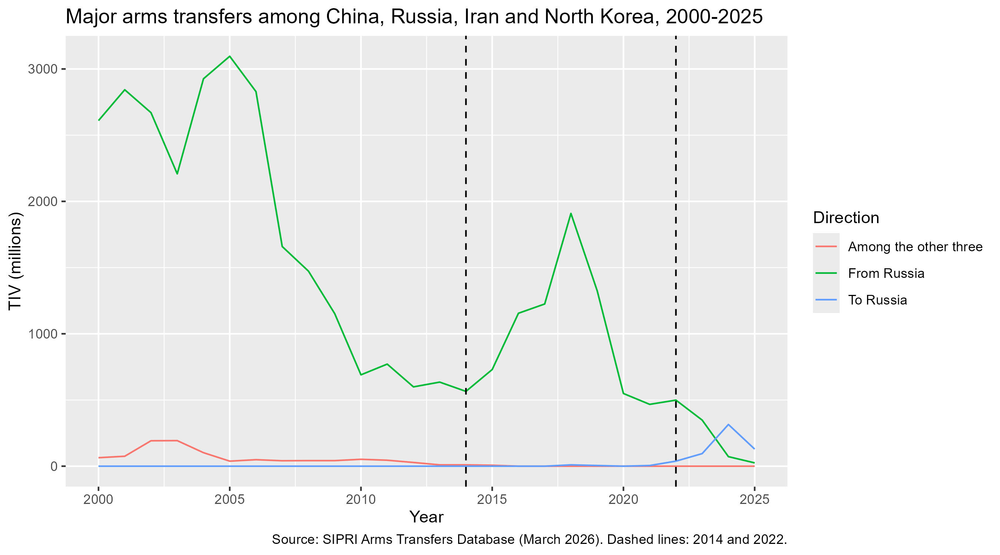
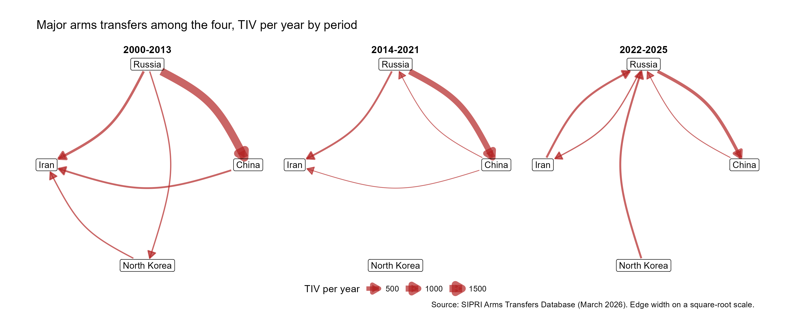

# Who arms whom? Major arms transfers among China, Russia, Iran and North Korea, 2000–2025

Francesco Sanna · November 2026 · R (tidyverse, janitor, igraph, ggraph)

**Bottom line:** ***In major arms transfers, the four are linked through Russia, not to each other: after 2015, China, Iran and North Korea record no transfers among themselves. Russia used to be the group's supplier. In 2024 and 2025 it received more major arms from the group than it sent to it.***

## 1. Question

Kendall-Taylor and Fontaine (2024) describe China, Russia, Iran and North Korea as an "axis of upheaval": not a bloc or an alliance, but four states whose cooperation has deepened since 2022. This project looks at one part of that cooperation that can be measured: what major arms moved between the four between 2000 and 2025, and in which direction?

- **Change:** How did transfers among the four change over time?
- **Asymmetry:** Who supplies, and who receives?
- **Dependence:** How much does each state rely on the other three for its recorded arms imports?

Arms transfers are one type of tie, not cooperation as a whole.

## 2. Data

- **Source:** SIPRI Arms Transfers Database, March 2026 release, downloaded on 10 November 2026 (https://www.sipri.org/databases/armstransfers).
- **Unit:** Trend-indicator value (TIV), in millions. TIV measures the volume of transfers, based on production costs, not their sales price.
- **Timing:** SIPRI records the year of delivery, not the year of the deal.
- **Coverage:** Major conventional weapons only, including drones from 150 kg. Small arms, ammunition and artillery under 100 mm are excluded, so North Korean artillery shells sent to Russia are not in the data.
- **Downloaded:** Every transfer from each of the four, to any recipient, plus each state's total imports: 1,202 supplier–recipient–year rows after cleaning.
- **Scope:** SIPRI gives recipients only for the suppliers selected. The data therefore cover two things: the complete network among the four (92 rows over 26 years), and each state's exports to everyone else. Their imports from other suppliers, such as France → China, are known only as totals. This is a four-state subnetwork, not the global arms trade, so global centrality is not computed: the four would be central by construction.

## 3. Method

- **Network:** The four states are the nodes. An edge A → B means A delivered major arms to B, weighted by TIV. With four states there are 12 possible directed edges.
- **Periods:** 2000–2013, 2014–2021 (after the annexation of Crimea) and 2022–2025 (after the full-scale invasion). The breaks were set from theory, before looking at the data. The periods have different lengths (14, 8 and 4 years), so volumes are compared as TIV per year: Russia → China, for example, averaged 937 TIV per year in 2014–2021. The annual series is also reported.
- **Density:** The share of the 12 possible edges that exist. In 2000–2013, 5 of 12 edges exist, a density of 0.417.
- **Reciprocity:** The share of edges whose reverse edge also exists. In 2022–2025, 4 of 5 edges are reciprocated, a reciprocity of 0.8. It counts whether a reverse edge exists, not how large it is.
- **Asymmetry:** For each pair, the share of the flow that goes one way: A → B ÷ (A → B + B → A). A value of 1 means one-way, 0.5 means balanced. In 2014–2021, Russia → China is 0.997.
- **Import dependence:** The share of a state's total recorded imports that comes from one of the other three. In 2022–2025, Iran supplied 51.4% of Russia's recorded imports.
- **Export partners:** The number of different recipient states each of the four supplied, across all recipients, not only the four. In 2022–2025, Russia supplied 21 states.
- **Tools:** R (tidyverse, janitor, igraph, ggraph). Cleaning is in `02_clean.R`, analysis and charts in `03_analysis.R`. Data decisions are recorded in `decisions.md`.

## 4. Findings


*Russia's supplies to the group were falling long before 2014. In 2024 and 2025, Russia received more major arms from the group than it sent.*

- **Density:** At most 5 of the 12 possible edges exist in any year.
- **Decline before Crimea:** Russia → China fell from 3,076 TIV in 2005 to 653 in 2010. It rose again after 2014, peaking at 1,906 in 2018, then fell to 25 in 2025.
- **One hub:** After 2015, China, Iran and North Korea record no major arms transfers among themselves. The last is China → Iran in 2015 (7 TIV).
- **Crossover in 2024:** Within the group, 2024 is the first year in which Russia received more (315 TIV) than it sent (72 TIV). The same holds in 2025 (129 against 25). Over 2022–2025 as a whole, Russia still sent the group more (944 TIV) than it received (577 TIV), because of its deliveries to China in 2022 and 2023.


*In 2022–2025, every edge runs to or from Russia. Edge width is on a square-root scale; exact values are in the tables.*

| Period | Edges | Density | Reciprocity |
|---|---|---|---|
| 2000–2013 | 5 | 0.417 | 0 |
| 2014–2021 | 4 | 0.333 | 0.5 |
| 2022–2025 | 5 | 0.417 | 0.8 |

- **Direction:** In 2000–2013, all of Russia's edges run outwards, to China, Iran and North Korea. In 2022–2025, Iran and North Korea both supply Russia.
- **Asymmetry:** Most pairs are almost entirely one-way. In 2014–2021, Russia sent China about 375 times more than China sent back (937 against 2.5 TIV per year). The least one-sided pair is Iran → Russia in 2022–2025 (0.825): about 74 TIV per year against 16.
- **Dependence:** In 2022–2025, Iran supplied 51.4% of Russia's recorded imports, North Korea 45.7% and China 2.8%. In the other direction, Russia took all of North Korea's recorded exports and about three-quarters of Iran's. These are shares of small totals: Russia's recorded imports in these four years were 578 TIV, against 8,016 TIV of exports.
- **Missing edges:** Four edges never appear in 2000–2025: China → North Korea, North Korea → China, Iran → China and Iran → North Korea.
- **Wider market:** Russia's exports to all recipients fell from about 6,100 TIV per year in 2000–2013 to about 2,000 in 2022–2025. In 2022–2025 it supplied 21 states, against 40 for China, and India was its largest client (3,744 TIV). Russia supplied 80 states in 2000–2013 and 58 in 2014–2021, but longer periods collect more clients, so these counts are not directly comparable with the 21.

**Implication:** In major arms transfers, the four are a set of separate ties to Russia, not a network in which each state supplies the others. The direction of those ties changed in 2024: Russia now receives more than it sends. This rests on two years of data and on one type of tie. Whether it holds for ammunition, technology or trade cannot be judged from this data.

## 5. Robustness

- **Different breaks (2012 and 2020):** The same edges appear in each period (5 / 4 / 5), so density and reciprocity are unchanged. Only volumes shift.
- **One break (2022):** 2000–2021 has 6 edges (density 0.5, reciprocity 0.33). 2022–2025 is unchanged (5 edges, 0.417, 0.8).
- **Dropping small edges (under 5 TIV per year):** 5 / 2 / 4 edges, density 0.417 / 0.167 / 0.333, reciprocity 0 / 0 / 0.5. Russia ↔ Iran is the only two-way tie left.

Which edges exist does not depend on where the breaks are. It does depend on very small flows: without them, 2014–2021 has only two edges, and the rise in reciprocity largely disappears, because part of it rests on small China → Russia flows. The 2024 crossover is read from the annual series, so the period breaks do not affect it.

## 6. Limits

- **Major weapons only:** No small arms, no ammunition and no artillery under 100 mm, so North Korean shells to Russia are missing, and support to armed groups (Hezbollah, the Houthis) is understated.
- **Secrecy:** North Korean and Iranian flows are secret or under-recorded.
- **One type of tie:** Arms transfers are not cooperation as a whole.
- **Four-state subgraph:** Pair-level data cover only flows from the four, not the global arms network.
- **Deliveries, not decisions:** Deliveries lag decisions, so the period breaks are approximate (checked in section 5), and yearly peaks cannot be tied to the politics of that year.
- **Two years:** The crossover rests on 2024 and 2025 only.
- **Reciprocity ignores weights:** Part of its rise rests on very small China → Russia flows.
- **Small volumes:** Iran's 297 TIV to Russia in 2022–2025 is less than a tenth of what Russia sent India in the same years (3,744).
- **What Iran sends:** Iran → Russia is probably mostly drones (SIPRI counts one-way attack drones as missiles). This has not been checked in the item-level data.
- **Chart scale:** The network chart uses a square-root scale for edge width. This keeps small edges visible but makes them hard to compare; exact values are in the tables.

## 7. Repository and how to run

```
.
├── README.md
├── decisions.md          data and analysis decisions
├── 02_clean.R            raw SIPRI files -> clean edge list and import totals
├── 03_analysis.R         metrics, robustness checks and charts
├── data/
│   ├── raw/              the 8 SIPRI CSV files (see below)
│   ├── edges_clean.csv   made by 02_clean.R
│   └── totals_four.csv   made by 02_clean.R
└── output/               tables (CSV) and charts (PNG), made by 03_analysis.R
```

1. Download the SIPRI files from https://www.sipri.org/databases/armstransfers: the TIV tables for 2000–2025, once with each of the four as supplier and once with each as recipient. Save them in `data/raw/` with the file names listed in `decisions.md`. This download is step 1, which is why the scripts start at 02.
2. Open the project folder in RStudio. Install the packages if needed: `install.packages(c("tidyverse", "janitor", "igraph", "ggraph"))`.
3. Run `02_clean.R`, then `03_analysis.R`.

**References**

Kendall-Taylor, A., & Fontaine, R. (2024). The axis of upheaval: How America's adversaries are uniting to overturn the global order. *Foreign Affairs, 103*(3), 50–63. https://www.foreignaffairs.com/china/axis-upheaval-russia-iran-north-korea-taylor-fontaine

SIPRI (2026). *SIPRI Arms Transfers Database*, March 2026 release. Stockholm International Peace Research Institute. https://www.sipri.org/databases/armstransfers
